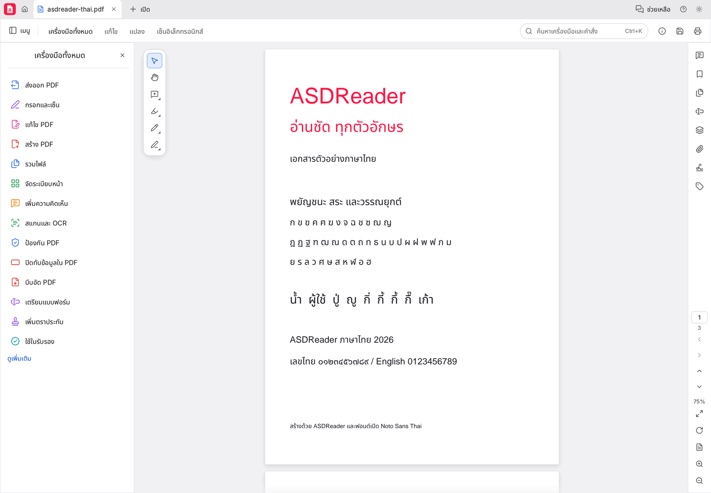
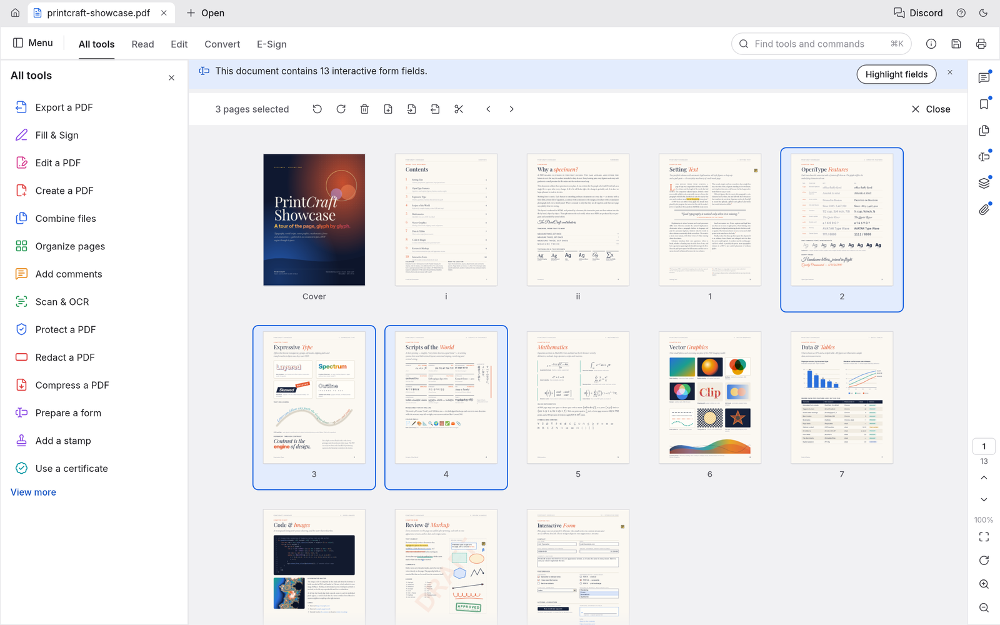

<p align="center">
  <picture>
    <source media="(prefers-color-scheme: dark)" srcset="docs/brand/asdreader-logo-white.svg">
    
  </picture>
</p>

<h1 align="center">ASDReader</h1>
<p align="center"><b>โปรแกรมอ่านและแก้ไข PDF ที่ใช้งานภาษาไทยได้เต็มรูปแบบ</b><br>
Windows และ Linux · ทำงานบนเครื่องของคุณ ไม่อัปโหลดเอกสาร · โอเพนซอร์ส</p>

<p align="center">
  <a href="https://github.com/mamankub/asdreader-help/releases/latest"><b>ดาวน์โหลด</b></a> ·
  <a href="https://mamankub.github.io/asdreader-help/manual/">คู่มือ</a> ·
  <a href="https://mamankub.github.io/asdreader-help/support/">ช่วยเหลือ</a> ·
  <a href="https://mamankub.github.io/asdreader-help/changelog/">มีอะไรใหม่</a>
</p>



ASDReader เป็นโปรแกรมอ่านและแก้ไขไฟล์ PDF สำหรับงานเอกสารและงานแบบ (CAD) ใช้เปิด ค้นหา แก้ไขข้อความไทย
จัดหน้า กรอกฟอร์ม เซ็นเอกสาร และพิมพ์ ทุกอย่างทำบนเครื่องของคุณ ไม่ต้องสมัครบัญชีและไม่ส่งเอกสารไปที่ใด

## จุดเด่น

| | |
|---|---|
| **ภาษาไทยครบ** | เมนูภาษาไทยด้วยฟอนต์ไทยแบบมีหัว แก้ไขข้อความไทยในไฟล์ PDF ได้ วรรณยุกต์และสระอยู่ถูกตำแหน่ง รวมถึงไฟล์ที่ใช้ฟอนต์ไทยแบบเก่า (TH SarabunPSK, Cordia, Angsana) |
| **ไฟล์ใหญ่และไฟล์งานแบบ** | เปิดแบบแปลนขนาดใหญ่ที่มีเส้นนับล้านเส้นและหลายเลเยอร์ได้เร็ว หน้าที่หนักทยอยแสดงขณะวาด ซูมและเลื่อนแล้ววาดเฉพาะส่วนที่อยู่ในจอ เส้นบางคมชัด |
| **ใช้ฟอนต์ในเครื่อง** | เลือกฟอนต์ที่ติดตั้งในคอมพิวเตอร์ (รวมไฟล์ `.ttc`) มาใช้กับข้อความที่แก้ไข |
| **ASD PDF Printer** | เครื่องพิมพ์ PDF ในรายการของ Windows พิมพ์จากโปรแกรมใดก็ได้ เลือกได้ว่าจะเก็บไฟล์ไว้ที่ไหน แล้วได้ไฟล์ PDF ที่ข้อความไทยถูกต้อง ค้นหาและคัดลอกได้ |
| **พิมพ์ตามเครื่องพิมพ์** | ใช้ความละเอียดและคุณภาพที่ตั้งไว้ใน Printing Preferences ของ Windows |
| **งานเอกสารครบ** | ค้นหา ไฮไลต์ โน้ต วาด จัดหน้า (ย้าย หมุน ลบ แทรก แยก รวม) กรอกฟอร์ม ลายเซ็นดิจิทัล รหัสผ่าน การปิดทับข้อมูล |



## ดาวน์โหลดและติดตั้ง

ดาวน์โหลดรุ่นล่าสุดได้ที่ **[หน้า Releases](https://github.com/mamankub/asdreader-help/releases/latest)**

| ไฟล์ | ใช้กับ |
|---|---|
| `asdreader-<รุ่น>-windows-x64.msi` | **ตัวติดตั้ง Windows** (แนะนำ) เลือกโฟลเดอร์ติดตั้งได้ ค่าเริ่มต้น `C:\Program Files\ASDReader` และเลือกติดตั้ง ASD PDF Printer ได้ |
| `ASDReader-<รุ่น>-windows-x64-portable.zip` | Windows แบบพกพา แตกไฟล์แล้วเปิด `ASDReader.exe` |
| `ASDReader-<รุ่น>-linux-x86_64.tar.gz` | Linux x86_64 (glibc 2.35 ขึ้นไป) |
| `SHA256SUMS.txt` | ค่าตรวจความถูกต้องของไฟล์ |

ต้องใช้ Windows 10 ขึ้นไปแบบ 64 บิต ขั้นตอนติดตั้ง การติดตั้งแบบเงียบสำหรับหลายเครื่อง และการตรวจไฟล์ อยู่ใน
[หน้าดาวน์โหลด](https://mamankub.github.io/asdreader-help/download/)

ตัวติดตั้งรุ่นปัจจุบันยังไม่มีลายเซ็นดิจิทัลที่ Windows รู้จัก Windows จึงอาจเตือนตอนติดตั้ง
สำหรับองค์กรที่ใช้ใบรับรองของตัวเอง ดู [packaging/windows/trust](packaging/windows/trust/README-TH.md)

## ภาษาไทย

- เมนูและข้อความในโปรแกรมเป็นภาษาไทย เลือกได้ที่ **การตั้งค่า… ▸ ภาษาของโปรแกรม** หรือเปิดด้วย `--language th`
- เมนูใช้ฟอนต์ไทยแบบมีหัวที่ติดตั้งในเครื่อง (Tahoma, Leelawadee UI, TH Sarabun ฯลฯ) ถ้าไม่มีจะใช้ Noto Sans Thai ที่มากับโปรแกรม
- แก้ไขข้อความไทยในไฟล์ PDF: จัดรูปอักษรด้วย OpenType วางสระบน สระล่าง และวรรณยุกต์ถูกตำแหน่ง
  และอ่านไฟล์ที่ใช้ฟอนต์ไทยแบบเก่าซึ่งเก็บวรรณยุกต์ไว้ในพื้นที่ส่วนตัวของฟอนต์ (PUA)
- เมื่อพิมพ์ตัวอักษรที่ฟอนต์ในไฟล์ไม่มี โปรแกรมจะหาฟอนต์ตัวเต็มชื่อเดียวกันในเครื่องให้อัตโนมัติ
- ค้นหาและคัดลอกข้อความไทยเรียงสระและวรรณยุกต์ถูกต้อง รวมถึงสระอำที่ถูกเก็บแยกส่วน ("นํ้า" อ่านเป็น "น้ำ")
- ซ่อมข้อความไทยในไฟล์ที่พิมพ์ด้วย "Microsoft Print to PDF": `asdreader-cli edit ไฟล์.pdf --repair-thai --out ใหม่.pdf`

**ข้อจำกัด:** การตัดบรรทัดยังไม่ใช้พจนานุกรมภาษาไทย ข้อความที่เพิ่มใหม่ (Add text) ยังเลือกได้เฉพาะ Helvetica, Times และ Courier
และไฟล์ PDF ที่ไม่มีข้อมูล Unicode ของฟอนต์อาจค้นหาหรือคัดลอกข้อความไทยไม่ได้

## สร้างจากซอร์ส

ต้องมี **Rust 1.95 ขึ้นไป**, Git และเครื่องมือคอมไพล์ของระบบ บน Linux ต้องมีแพ็กเกจพัฒนาของ X11/Wayland และ `libxkbcommon`
(ดู [คู่มือพัฒนา](docs/development.md))

```sh
git clone https://github.com/mamankub/ASDReader.git
cd ASDReader

# ชุดฟอนต์เป็น build input แยกต่างหาก ไม่ได้เก็บไฟล์ฟอนต์ไว้ใน repo นี้
git clone https://github.com/mamankub/asdesign-fonts.git ../asdesign-fonts
git -C ../asdesign-fonts checkout c76dcbc93b13d3b6981c12602bc545ea7ec3e67a

# รันโปรแกรม (ตรวจว่ามีฟอนต์ไทยก่อน build)
cargo xtask asdreader run -- --language th

# เปิดเอกสาร หรือสร้างรุ่น release
cargo xtask asdreader run -- เอกสาร.pdf --language th
cargo xtask asdreader build --release
```

คำสั่ง `cargo xtask asdreader` หาชุดฟอนต์ที่ `../asdesign-fonts` หรือที่ `ASDESIGN_FONTS_DIR`
และจะหยุด build พร้อมแจ้งสาเหตุถ้าไม่มีฟอนต์ไทย ไฟล์โปรแกรมที่ได้คือ `ASDReader` (Windows: `ASDReader.exe`) และ `asdreader-cli`

ตัวติดตั้ง Windows (MSI) สร้างด้วย WiX ผ่าน GitHub Actions ([release.yml](.github/workflows/release.yml))
รายละเอียดอยู่ใน [docs/releasing.md](docs/releasing.md) และ [docs/asd-pdf-printer.md](docs/asd-pdf-printer.md)

## CLI และงานอัตโนมัติ

```sh
cargo run -p asdreader-cli -- info เอกสาร.pdf
cargo run -p asdreader-cli -- render เอกสาร.pdf --page 1 --dpi 150 --out หน้า1.png
cargo run -p asdreader-cli -- text เอกสาร.pdf

# รายการเครื่องมือ และการทำงานตาม JSON script ที่จำกัดโฟลเดอร์อ่าน/เขียน
cargo run -p asdreader-cli -- tools
cargo run -p asdreader-cli -- run --script steps.json --root ./work

# เซิร์ฟเวอร์ MCP สำหรับ AI agent (เปิดเมื่อสั่งเท่านั้น)
cargo run -p asdreader-cli -- mcp
```

ดูรายละเอียดใน [คู่มือ automation](crates/automation/README.md) โปรแกรมเดสก์ท็อปมีช่องทางควบคุมแบบ opt-in ผ่าน `--control FILE`
(ผูกกับ loopback และใช้ token ใหม่ทุกครั้ง)

## พัฒนาและทดสอบ

```sh
export ASDESIGN_FONTS_DIR="$PWD/../asdesign-fonts"
export ASDESIGN_FONTS_REQUIRED=1
export ASDREADER_REQUIRE_THAI=1
export ASDREADER_SYSTEM_FONTS=0

cargo fmt --all --check
cargo clippy --workspace --all-targets --locked -- -D warnings
cargo test --workspace --locked
cargo xtask layers
cargo xtask assets
```

| ส่วน | หน้าที่ |
|---|---|
| `crates/render` | วาดหน้า (render pool, ดัชนีเนื้อหาหน้า, ภาพที่ถอดรหัสแล้วใช้ร่วมกัน) และดึงข้อความ |
| `crates/fonts` | ฟอนต์ การจัดรูปอักษรไทย และการซ่อมข้อความไทย |
| `crates/edit` | แก้ไขเนื้อหา PDF |
| `crates/engine` | เอกสารที่เปิด, undo/redo และชุดคำสั่ง |
| `crates/ui-egui` | หน้าจอโปรแกรม |
| `crates/automation`, `apps/asdreader-cli` | CLI, script และ MCP |
| `vendor/` | ไลบรารีที่แก้เพิ่มสำหรับ ASDReader (ดู [vendor/README.md](vendor/README.md)) |

วัดความเร็วการวาดหน้าด้วย `crates/render/examples/page_timing.rs` และไฟล์แบบแปลนทดสอบจาก `crates/render/examples/synth_sheet.rs`
ขอบเขตการทดสอบและสิ่งที่ยังไม่ได้ยืนยันอยู่ใน [รายงานตรวจ ASDReader](docs/asdreader-validation.md)

## แจ้งปัญหา

แจ้งได้ที่ [Issues](https://github.com/mamankub/asdreader-help/issues/new/choose) โปรดระบุรุ่นโปรแกรม รุ่น Windows
ขั้นตอนที่ทำให้เกิดปัญหา และถ้าเป็นไปได้ ให้แนบไฟล์ตัวอย่างที่ไม่มีข้อมูลส่วนตัวหรือข้อมูลลับ

## สิทธิ์การใช้งาน

ซอร์สโค้ดใช้สิทธิ์ [MIT](LICENSE-MIT) หรือ [Apache-2.0](LICENSE-APACHE) ตามที่ผู้ใช้เลือก
ASDReader พัฒนาต่อจาก PdfCraft ของ ArtCraft Team และผู้ร่วมพัฒนา PdfCraft ภายใต้สิทธิ์เดียวกัน
ลิขสิทธิ์โค้ดส่วนที่มาจาก PdfCraft ยังเป็นของผู้เขียนเดิม ผู้ร่วมพัฒนา ASDReader ถือลิขสิทธิ์เฉพาะส่วนที่แก้ไขและเพิ่มเติม
ประกาศลิขสิทธิ์ฉบับเต็ม รวมถึงของ shared libraries และไลบรารีอื่นที่ใช้ อยู่ใน [NOTICE](NOTICE)

โลโก้ ASDReader ([docs/brand](docs/brand/)) ฟอนต์ ไอคอน และไฟล์อื่น ๆ เป็นไปตามสิทธิ์ของแต่ละรายการใน
[ATTRIBUTION.md](ATTRIBUTION.md) ส่วนฟอนต์จาก build input ดูที่
[asdesign-fonts](https://github.com/mamankub/asdesign-fonts/blob/c76dcbc93b13d3b6981c12602bc545ea7ec3e67a/ATTRIBUTION.md)
