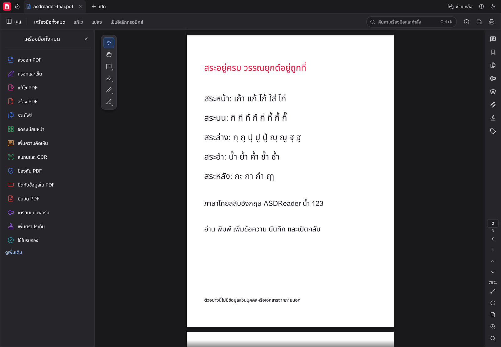

<p align="center">
  <picture>
    <source media="(prefers-color-scheme: dark)" srcset="docs/brand/asdreader-logo-white.svg">
    
  </picture>
</p>

<h1 align="center">ASDReader</h1>
<p align="center"><b>อ่านและจัดการ PDF พร้อมการแสดงผลภาษาไทย</b><br>พัฒนาด้วย Rust ต่อยอดจาก PdfCraft · ใช้งานบนเดสก์ท็อปและเว็บ</p>


ASDReader เป็นโปรแกรมอ่านและแก้ไข PDF แบบโอเพนซอร์ส สำหรับเปิดเอกสาร ค้นหาข้อความ จัดหน้า ใส่คำอธิบาย และทำงานกับเอกสารในเครื่อง โดยไม่ต้องสมัครบัญชี ตัวโปรแกรมต่อยอดจาก [PdfCraft](https://github.com/storytold/pdfcraft) ภายใต้สิทธิ์ `MIT OR Apache-2.0` และใช้แบรนด์ ASDReader ของตนเอง

ภาพประกอบใน README นี้เป็นภาพที่ render จาก **UI ของ ASDReader จริง** พร้อมเอกสารสังเคราะห์ที่สร้างด้วย PDF writer ของโปรเจกต์ ใช้ฟอนต์เปิด Inter และ Noto Sans Thai ไม่มีภาพจากโปรแกรม PDF อื่นหรือเอกสารของผู้ใช้

## ความสามารถหลัก

| งาน | สิ่งที่ทำได้ |
|---|---|
| อ่านเอกสาร | ซูม หมุนหน้า บุ๊กมาร์ก ภาพย่อ โหมดอ่าน สองหน้าคู่ โหมดสว่างและมืด |
| ค้นหาและเลือกข้อความ | ค้นหา เลือก และคัดลอกข้อความจาก PDF ที่มี text layer |
| จัดหน้า | ย้าย หมุน ลบ แทรก แยกหน้า รวมเอกสาร และปรับกล่องขอบหน้า |
| แก้ไขและใส่คำอธิบาย | เพิ่มข้อความ ไฮไลต์ โน้ต รูปร่าง เส้นวาด และการตอบความคิดเห็น |
| แบบฟอร์มและการเซ็น | กรอกฟอร์ม ใส่ลายเซ็น และเครื่องมือเกี่ยวกับลายเซ็นดิจิทัลตามที่ engine รองรับ |
| ปกป้องเอกสาร | รหัสผ่าน สิทธิ์เอกสาร การปิดทับข้อมูล และการล้างข้อมูลแฝง |
| เครื่องมืออัตโนมัติ | CLI, JSON scripts และ MCP ที่เปิดใช้งานเมื่อผู้ใช้เรียกเอง |

โปรเจกต์ยังอยู่ระหว่างพัฒนา ความสามารถบางส่วนมีข้อจำกัด โดยเฉพาะการแก้ข้อความเดิมใน PDF ที่ฝังฟอนต์มาเพียงบางตัวอักษร การแปลงไฟล์ Office, OCR ภาษาไทย และฟอร์ม XFA โปรดดู [สถานะความสามารถ](docs/target-app-parity.md) ซึ่งเก็บข้อมูลประเมินจากต้นทาง และ [รายการช่องว่าง](docs/gaps.md)

## ภาษาไทยและฟอนต์

ASDReader ใช้ **Noto Sans Thai** จากชุด [craft-fonts](https://github.com/storytold/craft-fonts) ที่ตรึง revision ไว้ รองรับพยัญชนะไทย รวมถึง ฃ ฅ สระ วรรณยุกต์ เครื่องหมาย และเลขไทย โดยใช้ OpenType shaping เพื่อวางรูปอักษรและเครื่องหมายประกอบ

การปรับใน fork นี้ครอบคลุม:

- จัดรูปข้อความไทยแยกจากข้อความอังกฤษที่อยู่ในบรรทัดเดียวกัน เพื่อให้สระอำและวรรณยุกต์ใช้กฎภาษาไทย
- เก็บสระบน สระล่าง และวรรณยุกต์ไว้กับตัวฐาน พร้อมป้องกันสระหน้า `เ แ โ ใ ไ` และสระหลัง `ะ า ำ ๅ` แยกบรรทัดออกจากตัวฐานขณะเพิ่มข้อความ
- เก็บ Unicode ต้นฉบับไว้สำหรับการอ่านและแก้ไขหลังบันทึก แยกจากรูปอักษรที่ใช้วาดบนหน้า
- ใช้ฟอนต์ไทยที่ฝังมากับ build ทั้งบนเดสก์ท็อปและ WebAssembly เพื่อไม่พึ่งฟอนต์ที่ติดตั้งอยู่ในเครื่อง
- ตรวจว่ามีฟอนต์ไทยก่อน build ผ่าน `cargo xtask asdreader` และตรวจตัวอักษรในทุกตระกูลฟอนต์ UI

**ขอบเขตที่ต้องเข้าใจ:** การตัดบรรทัดแบบนี้รักษาชุดอักษรและสระ แต่ยังไม่ใช่การตัดคำด้วยพจนานุกรมภาษาไทย PDF เก่าที่ไม่มีฟอนต์หรือแผนที่ Unicode ที่ถูกต้องอาจค้นหา/คัดลอกไม่ได้ตามต้นฉบับ ฟอนต์ของช่องแบบฟอร์มและ annotation เป็นอีกเส้นทางหนึ่งที่ยังต้องตรวจตามเอกสาร ไม่ได้อ้างว่าทุก PDF หรือทุกฟอนต์ภายนอกจะถูกต้องทั้งหมด

เลือกเมนู **Edit → Preferences… → Language → ไทย** หรือใช้ตัวเลือก `--language th` ตอนเริ่มโปรแกรม การเปลี่ยนภาษาหน้าจอไม่แปลเนื้อหาเอกสาร ชื่อไฟล์ หรือข้อมูลของผู้ใช้



## ดาวน์โหลดรุ่นแรก

[ASDReader v0.13.1](https://github.com/mamankub/ASDReader/releases/tag/v0.13.1) เป็นรุ่นแรกของ fork นี้ โดยต่อเลขเวอร์ชันจาก PdfCraft 0.13.0 เพื่อไม่ชน tag ที่นำเข้าจากต้นทาง

- **Windows x64:** แตกไฟล์ `ASDReader-0.13.1-windows-x64-portable.zip` แล้วเปิด `pdfcraft.exe` ไม่ต้องติดตั้ง MSI; การตั้งค่าอยู่ข้างโปรแกรมใน `PdfCraftData`
- **Linux x86_64:** แตกไฟล์ `ASDReader-0.13.1-linux-x86_64.tar.gz` แล้วเรียก `bin/pdfcraft --language th` ต้องมี glibc 2.35 ขึ้นไป, ระบบหน้าต่าง X11/Wayland, libxkbcommon และไดรเวอร์ Vulkan/EGL
- ทั้งสองแพ็กเกจมีฟอนต์ไทย, CLI, OCR models เดิมของต้นทาง และไฟล์สิทธิ์การใช้งาน; ไม่ได้เพิ่ม OCR ภาษาไทย
- ตรวจความครบถ้วนด้วย `SHA256SUMS.txt` จากหน้า release; Windows portable ยังไม่มีลายเซ็นดิจิทัล และรุ่นนี้ยังไม่มีแพ็กเกจ macOS/Web/ARM64

Repository นี้ยังเป็น private: ผู้ดาวน์โหลดต้องมีสิทธิ์ GitHub ของ repo และการตรวจอัปเดตจากในแอปแบบไม่ล็อกอินอาจเข้าถึง release ไม่ได้

ดู [บันทึก v0.13.1 และวิธีสร้าง release](docs/releases/v0.13.1.md) สำหรับขอบเขตการทดสอบและข้อจำกัด

## เริ่มใช้งานจากซอร์ส

ต้องมี **Rust 1.95 ขึ้นไป**, Git และเครื่องมือคอมไพล์ของระบบ บน Linux ต้องมีแพ็กเกจพัฒนาสำหรับ X11/Wayland และ `libxkbcommon` ตาม [คู่มือพัฒนา](docs/development.md)

```sh
git clone https://github.com/mamankub/ASDReader.git
cd ASDReader

# ชุดฟอนต์เป็น build input ภายนอก ไม่คัดลอกฟอนต์เข้า repo นี้
git clone https://github.com/storytold/craft-fonts.git ../craft-fonts
git -C ../craft-fonts checkout 3d9ab3a132ed0eff457e424226a435a901da30d3

# ตรวจฟอนต์ไทยก่อนเริ่มแอป
cargo xtask asdreader run -- --language th

# เปิดเอกสาร หรือสร้าง binary แบบ release
cargo xtask asdreader run -- document.pdf --language th
cargo xtask asdreader build --release
```

คำสั่ง `asdreader` จะหา `../craft-fonts` โดยอัตโนมัติ หรือใช้ตำแหน่งจาก `CRAFT_FONTS_DIR` แล้วเปิด `CRAFT_FONTS_REQUIRED=1` และ `ASDREADER_REQUIRE_THAI=1` เพื่อให้ build ล้มพร้อมข้อความชัดเจนหากไม่มีชุดฟอนต์หรือไม่มี face ภาษาไทย

ชื่อ Cargo package, binary และ ID สำหรับ packaging บางส่วนยังใช้ `pdfcraft` เพื่อให้ทำงานกับโครงสร้างเดิมได้ เช่น `target/release/pdfcraft` และ `pdfcraft-cli` ชื่อที่แสดงในแอปและ artwork เป็น ASDReader ส่วนข้อมูลการตั้งค่าที่เก็บไว้ยังใช้ตำแหน่งเดิม

ดูไฟล์ที่มีเผยแพร่ได้ที่ [Releases ของ ASDReader](https://github.com/mamankub/ASDReader/releases) ตัวติดตั้งและการลงลายมือชื่อของ PdfCraft ต้นทางไม่ใช่ตัวติดตั้งหรือใบรับรองของ ASDReader

## CLI และการควบคุมด้วย agent

```sh
# แสดงเครื่องมือที่ engine มี
cargo run -p pdfcraft-cli -- tools

# ทำงานตาม JSON script โดยจำกัดพื้นที่อ่าน/เขียน
cargo run -p pdfcraft-cli -- run --script steps.json --root ./work

# เปิด MCP เฉพาะเมื่อมีผู้เรียก ไม่เปิด listener โดยอัตโนมัติ
cargo run -p pdfcraft-cli -- mcp
```

หาก script เขียนข้อความไทย ต้องตั้ง `CRAFT_FONTS_DIR=../craft-fonts ASDREADER_REQUIRE_THAI=1` ตอน build CLI ด้วย รายละเอียดอยู่ใน [คู่มือ automation](crates/automation/README.md)

แอปเดสก์ท็อปมี control channel แบบ opt-in ผ่าน `--control FILE` สำหรับ `inspect`, `click`, `type` และ `screenshot` โดยผูกกับ loopback และใช้ token ใหม่ทุกครั้ง ไม่เปิดใช้งานเอง

## พัฒนาและทดสอบ

```sh
export CRAFT_FONTS_DIR="$PWD/../craft-fonts"
export CRAFT_FONTS_REQUIRED=1
export ASDREADER_REQUIRE_THAI=1
export PDFCRAFT_SYSTEM_FONTS=0

cargo fmt --all --check
cargo xtask asdreader test
cargo test -p pdfcraft-ui-egui --features eframe/x11 --test it thai -j 2 --locked
cargo clippy -p pdfcraft-fonts -p pdfcraft-edit -j 2 --all-targets -- -D warnings
cargo xtask layers
cargo xtask assets
```

ตัวเลือก `eframe/x11` ในตัวอย่างใช้สำหรับเครื่องทดสอบ Linux แบบ headless ให้เลือก backend ให้ตรงกับแพลตฟอร์มเมื่อทดสอบที่อื่น ฟอนต์ระบบถูกปิดในขั้นตอนถ่ายภาพและทดสอบชุดนี้ เพื่อไม่ให้ผลผ่านจากฟอนต์ที่ไม่ได้ส่งไปกับแอป

โครงสร้างหลักประกอบด้วย `crates/fonts` สำหรับฟอนต์และ shaping, `crates/edit` สำหรับแก้เนื้อหา PDF, `crates/render` สำหรับ render/ดึงข้อความ, `crates/engine` สำหรับ session และ undo, `crates/ui-egui` สำหรับ UI และ `crates/automation` สำหรับ CLI/MCP

ดูคำสั่ง ผลทดสอบ และขอบเขตที่ยังไม่ยืนยันใน [รายงานตรวจ ASDReader](docs/asdreader-validation.md)


## สร้างภาพประกอบใหม่จาก ASDReader

```sh
export CRAFT_FONTS_DIR="$PWD/../craft-fonts"
export ASDREADER_REQUIRE_THAI=1
export PDFCRAFT_SYSTEM_FONTS=0

cargo run -p pdfcraft-edit --example asdreader_demo --locked
cargo build -p pdfcraft-ui-egui --example shot --features eframe/x11 -j 2 --locked

target/debug/examples/shot docs/images/asdreader-thai.png dist/demo/asdreader-thai.pdf --language th --panel none --zoom 75 --size 1440x1000 --scale 2 --width 1600
target/debug/examples/shot docs/images/asdreader-dark.png dist/demo/asdreader-thai.pdf --language th --theme dark --page 2 --panel none --zoom 75 --size 1440x1000 --scale 2 --width 1600
target/debug/examples/shot docs/images/asdreader-home.png --language th --size 1440x1000 --scale 2 --width 1600
```

หลังสร้าง asset ใหม่ให้อัปเดต SHA-256 ใน `ATTRIBUTION.toml` แล้วรัน `cargo xtask assets --write` ตาม [กฎของโปรเจกต์](AGENTS.md) ภาพทั้งหมดต้องมาจากแอปนี้และเอกสารสังเคราะห์ที่ใช้ asset ภายใต้สิทธิ์ที่อนุญาต

## สิทธิ์และเครดิต

ซอร์สใช้สิทธิ์ [MIT](LICENSE-MIT) หรือ [Apache-2.0](LICENSE-APACHE) ตามที่ผู้ใช้เลือก คงเครดิตและประกาศที่จำเป็นของ ArtCraft Team, PdfCraft contributors และ dependency ไว้ใน [NOTICE](NOTICE)

logo/icon ของ ASDReader เป็นรูปทรงต้นฉบับสีแดงนีออน `#FF1744` และขาว `#FFFFFF` ส่วน wordmark ใช้เส้นอักษรจาก Inter ที่มีสิทธิ์ OFL ฟอนต์ Lucide icons และ asset อื่นคงสิทธิ์ของเจ้าของตาม [ATTRIBUTION.md](ATTRIBUTION.md) ฟอนต์จาก build input มีรายละเอียดใน [craft-fonts attribution](https://github.com/storytold/craft-fonts/blob/3d9ab3a132ed0eff457e424226a435a901da30d3/ATTRIBUTION.md)

แจ้งปัญหาได้ที่ [Issues ของ ASDReader](https://github.com/mamankub/ASDReader/issues) พร้อมรุ่นโปรแกรม ขั้นตอนทำซ้ำ และ PDF ตัวอย่างที่ไม่มีข้อมูลส่วนบุคคล
