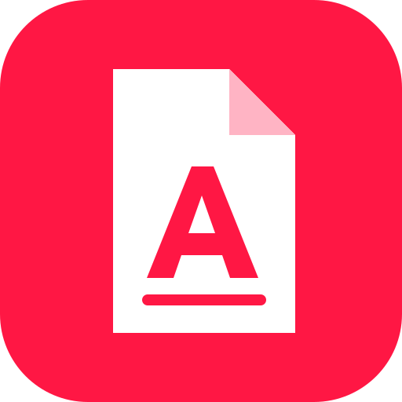

# ไอคอน ASDReader

สัญลักษณ์เอกสารพับมุมกับตัว A ใช้สีแดงนีออน `#FF1744` และขาว `#FFFFFF` สร้างจากรูปทรงเวกเตอร์ต้นฉบับ ไม่มีฟอนต์หรือภาพจากผลิตภัณฑ์อื่น

ไฟล์ชื่อ `asdreader.*` และ Linux ID เดิมคงไว้เพื่อรองรับระบบ packaging เดิม แต่ภาพเป็น ASDReader ทุกขนาด

| ไฟล์ | การใช้งาน |
|---|---|
| `asdreader.svg`, `asdreader-small.svg` | ต้นฉบับ SVG และสัญลักษณ์ในแอป |
| `asdreader-document.svg` | ไอคอนเอกสาร |
| `asdreader.ico`, `asdreader-document.ico` | Windows: 16–256 px |
| `asdreader.icns`, `asdreader-1024.png` | macOS: 16–1024 px บนพื้นที่โปร่งใส |
| `hicolor/` | Linux และ runtime icon: 16–512 px พร้อม SVG |

สร้างไฟล์ใหม่ด้วย `packaging/icons.sh` (ต้องมี `resvg` และ Python 3) รองรับการสร้าง ICNS บน Linux ด้วย แล้วอัปเดต hash ใน `ATTRIBUTION.toml` และรัน `cargo xtask assets --write`.

สิทธิ์ใช้งาน: [MIT OR Apache-2.0](LICENSE.txt)
