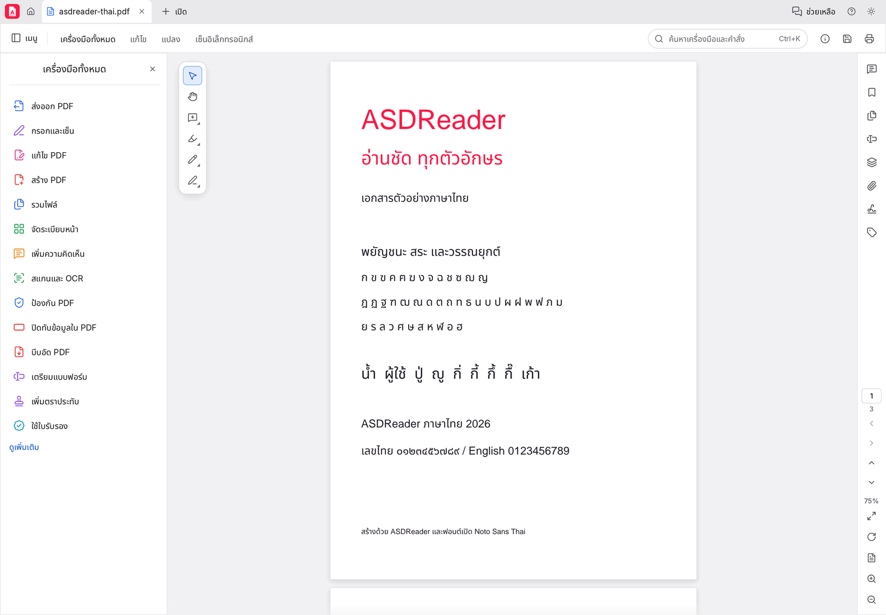

# ASDReader v0.13.1 — รุ่นแรก

วันที่: 2026-11-03 · ต่อจากฐาน PdfCraft 0.13.0 · สถานะการเผยแพร่และไฟล์จริง: [GitHub Release](https://github.com/mamankub/ASDReader/releases/tag/v0.13.1)

## สิ่งที่เปลี่ยน

- โลโก้และไอคอนเอกสาร A โทนแดงนีออน–ขาว พร้อมชื่อ ASDReader ในแอปและ README ภาษาไทย
- จัดรูปสระอำและวรรณยุกต์ให้ถูกต้องเมื่อข้อความไทยตามหลังอังกฤษ และป้องกันสระหน้า/สระหลังแยกบรรทัดจากตัวฐานขณะเพิ่มข้อความ
- ใช้ Noto Sans Thai ที่ฝังมากับโปรแกรม และหยุด build หากไม่มีฟอนต์ไทย ไม่อาศัยฟอนต์ระบบในการทดสอบ
- ภาพ README มาจาก UI จริงของ ASDReader กับ PDF สังเคราะห์ของโปรเจกต์
- เปลี่ยน OCR models เป็น ONNX จาก URL ทางการที่ตรวจ SHA-256 หลังผู้พัฒนายุติ URL RTEN เดิม; ตัวโหลดเลือก ONNX แบบครบคู่ก่อน และยังอ่าน RTEN แบบครบคู่ที่ติดตั้งไว้ได้

## ไฟล์สำหรับรุ่นนี้

| ไฟล์ | การใช้งาน |
|---|---|
| `ASDReader-0.13.1-windows-x64-portable.zip` | แตกไฟล์แล้วเปิด `pdfcraft.exe`; มี `pdfcraft-cli.exe` และโหมด portable; ไม่มี MSI และยังไม่ได้เซ็นดิจิทัล |
| `ASDReader-0.13.1-linux-x86_64.tar.gz` | แตกไฟล์แล้วเรียก `bin/pdfcraft --language th`; ต้องมี glibc ≥ 2.35, X11/Wayland, libxkbcommon และ Vulkan/EGL |
| `SHA256SUMS.txt` | SHA-256 ของแพ็กเกจทั้งสอง |
| `SOURCE_COMMIT.txt` | commit ที่ใช้สร้างแพ็กเกจและชี้ด้วย tag `v0.13.1` |

ยังไม่มีแพ็กเกจ macOS, ARM64 หรือ Web ในรุ่นนี้ ชื่อ binary และตำแหน่งเก็บค่าบางส่วนยังใช้ `pdfcraft` เพื่อคงความเข้ากันได้กับโค้ดต้นทาง

Repository ยังเป็น private: ต้องมีสิทธิ์ GitHub จึงจะดาวน์โหลดได้ เมนูตรวจอัปเดตในแอปเรียก GitHub โดยไม่แนบ token จึงอาจเข้าไม่ถึง release ของ private repository; ไม่มีการฝัง credential ลงในโปรแกรม

## การตรวจและข้อจำกัด

ผลตรวจในเครื่องก่อน release อยู่ที่ [รายงาน validation](../asdreader-validation.md) รวม regression ของการจัดรูปไทย การเก็บ Unicode การบันทึก/เปิดใหม่ และการทดสอบ glyph ไทยที่ UI scale 1, 1.5 และ 2

Release workflow ตรวจ SHA-256 ของฟอนต์จาก revision `3d9ab3a132ed0eff457e424226a435a901da30d3` ก่อน build และใช้ `--release --locked` ทั้งสองแพลตฟอร์ม ฝั่ง Linux รัน fonts/edit/OCR unit tests และ engine Thai regression เพิ่มหลังสร้างแพ็กเกจ ฝั่ง Windows ตรวจ PE architecture/subsystem และเรียก CLI `--version` ภายใน runner ผลผ่านใน CI ไม่ใช่การยืนยันว่าทดสอบ GUI บนทุกเครื่องแล้ว

ยังไม่มี dictionary segmentation หรือ OCR ภาษาไทย เส้นทางฟอนต์ของฟอร์มและ annotation ยังต้องตรวจเพิ่ม และ PDF ที่ไม่มีฟอนต์หรือ Unicode mapping ที่ถูกต้องอาจแสดง/คัดลอกได้ไม่ครบ

## สร้างซ้ำและเผยแพร่

1. ใช้ commit ที่ต้องการเผยแพร่และยืนยันว่า Cargo.toml/Cargo.lock มีเวอร์ชันตรงกัน
2. เรียก workflow `Release` บน ref นั้น โดยกรอก `version=0.13.1` เพื่อยืนยันเวอร์ชัน (ไม่เปลี่ยนซอร์ส): `gh workflow run release.yml --ref <branch> -f version=0.13.1`
3. ตรวจให้ทั้งสอง jobs ผ่าน ดาวน์โหลด artifacts และตรวจ checksum กับ `SOURCE_COMMIT.txt` ว่าตรงกัน
4. สร้างและ push tag ที่ commit ดังกล่าว แล้วสร้าง GitHub Release พร้อมแพ็กเกจ checksum และบันทึกภาษาไทย โดยต้องได้รับอนุมัติขั้น commit/push/release จากเจ้าของก่อน

Workflow มีสิทธิ์อ่าน repository เท่านั้น และไม่เผยแพร่หรือ merge branch เอง
